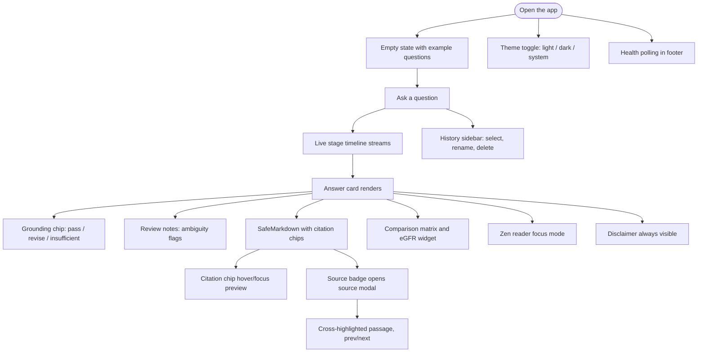
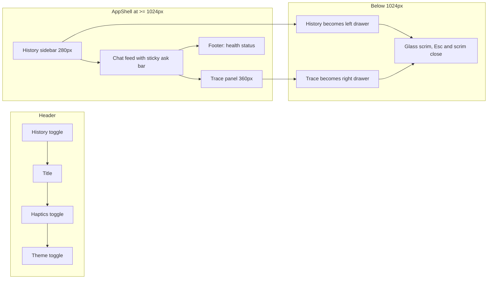
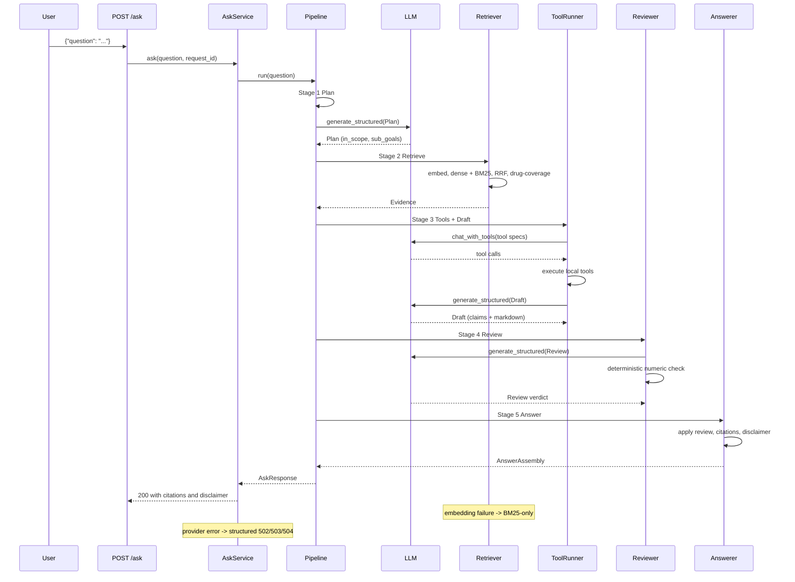
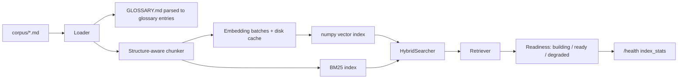
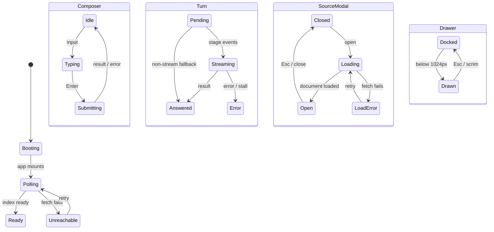

# Synapse — Agentic Pharmacology Research Assistant

Synapse answers compound pharmacology questions from a local corpus of FDA/DailyMed
drug labels and MedlinePlus patient monographs. It runs a strict five-stage agent
pipeline — **Plan → Retrieve → Tools → Review → Answer** — and returns a **cited**
Markdown answer that names its source files and always ends with a medical disclaimer.

This is a research and educational tool, **not medical advice**. It does not diagnose,
prescribe, or give personalized dosing instructions; it answers strictly from the
retrieved label text and says "insufficient evidence" when the corpus does not support
an answer.

## Features

- **Strict five-stage pipeline** with typed stage inputs/outputs, enforced ordering,
  and a per-stage event trace (`backend/app/agent/`).
- **Hybrid retrieval** combining dense numpy cosine similarity and a dependency-free
  BM25 index, fused with reciprocal rank fusion (`k = 60`), with glossary-based
  abbreviation expansion and a drug-coverage rule (`backend/app/retrieval/`).
- **Agent-chosen local tools** — `glossary_lookup`, `label_section_lookup`,
  `threshold_check` — selected through native function calling, never keyword-routed
  (`backend/app/agent/tools/`).
- **Grounding review** — a separate critic LLM call plus deterministic numeric checks
  flags unsupported claims before the answer is emitted (`backend/app/agent/review.py`).
- **Cited answers** with inline `[S1]` markers, a `sources` list, per-citation excerpts
  and a disclaimer injected by code.
- **Streaming trace** — `POST /ask/stream` emits stage-by-stage SSE events, shown live
  in the UI's trace panel.
- **Interactive citations** — hover/focus previews of the exact source passage, and a
  source reader modal with cross-highlighted passages.
- **Comparison matrix and eGFR widget** for multi-drug questions and renal thresholds.
- **Client-side history** — persisted, quota-safe sessions in the browser's local
  storage; no server-side state.
- **Themed, accessible UI** — nine-hex palette with light/dark/system themes, glass
  overlays, mobile drawers, safe-area support and haptics (feature-detected).

## Quick start (Docker — the graded path)

The container is fully self-contained: the only external dependency is an
OpenAI-compatible endpoint. Build and run it with the exact graded command:

```bash
docker build -t agent .
docker run -p 8000:8000 --env-file .env agent
```

Create `.env` from the placeholder template first:

```bash
cp .env.example .env
```

Only four variables are required; every other setting has a safe default:

| Variable                 | Required | Default                  | Purpose                        |
| ------------------------ | -------- | ------------------------ | ------------------------------ |
| `OPENAI_API_KEY`         | yes      | —                        | API key for the LLM proxy      |
| `OPENAI_BASE_URL`        | yes      | —                        | OpenAI-compatible base URL     |
| `OPENAI_MODEL`           | yes      | —                        | Chat model name                |
| `OPENAI_EMBEDDING_MODEL` | no       | `text-embedding-3-small` | Embedding model name           |

At startup the in-memory index builds in a background task; `GET /health` returns
HTTP 200 immediately and throughout the build. Open the UI at **http://localhost:8000/**
or the OpenAPI docs at **http://localhost:8000/docs**. If embeddings are unavailable
the app degrades to BM25-only retrieval (reported as `retrieval_mode: "bm25_only"`).

## Configuration reference

All values are read from the environment (and an optional `.env`); string values are
stripped of surrounding whitespace and one pair of matching quotes. The table lists the
`Settings` fields in `backend/app/core/config.py`:

| Variable                 | Default                  | Purpose                                    |
| ------------------------ | ------------------------ | ------------------------------------------ |
| `OPENAI_API_KEY`         | `""`                     | LiteLLM proxy key                          |
| `OPENAI_BASE_URL`        | `""`                     | LiteLLM proxy base URL                     |
| `OPENAI_MODEL`           | `""`                     | Chat model name                            |
| `OPENAI_EMBEDDING_MODEL` | `text-embedding-3-small` | Embedding model name                       |
| `LLM_PROVIDER`           | `openai`                 | `fake` enables scriptable fakes (tests)    |
| `CORPUS_DIR`             | `corpus`                 | Corpus location (`/app/corpus` in Docker)  |
| `CACHE_DIR`              | `/tmp/synapse-cache`     | On-disk embedding cache                    |
| `MAX_SUB_GOALS`          | `5`                      | Maximum planning sub-goals                 |
| `MAX_TOOL_CALLS`         | `4`                      | Maximum tool calls per request             |
| `REQUEST_TIMEOUT_S`      | `90`                     | Hard request timeout                       |
| `CHUNK_MAX_TOKENS`       | `800`                    | Target chunk size                          |
| `CHUNK_OVERLAP_TOKENS`   | `60`                     | Chunk overlap                              |
| `CHARS_PER_TOKEN`        | `4.0`                    | Token-count approximation                  |
| `RRF_K`                  | `60`                     | Reciprocal rank fusion constant            |
| `RETRIEVAL_TOP_K`        | `12`                     | Candidates per sub-goal                    |
| `RETRIEVAL_TOKEN_BUDGET` | `3000`                   | Retrieved-evidence token budget            |
| `INDEX_READY_TIMEOUT_S`  | `30.0`                   | `/ask` readiness wait                      |
| `LOG_LEVEL`              | `INFO`                   | Logging level                              |
| `APP_VERSION`            | `0.1.0`                  | Reported on `/health`                      |

## Local development

Backend (Python 3.11+, from the repository root):

```bash
python -m venv .venv
source .venv/bin/activate        # Windows PowerShell: .venv\Scripts\Activate.ps1
pip install -e ".[dev]"
ruff check .
mypy
pytest
```

Frontend (Node 18+, from `frontend/`):

```bash
npm ci
npm run dev                      # dev server with a proxy to http://localhost:8000
npm run build                    # tsc --noEmit && vite build
npm run lint
npm run test                     # vitest
```

## API reference

All responses carry an `X-Request-ID` header. Errors use one JSON shape:
`{"error": {"code", "message", "request_id"}}`.

### `GET /health`

Always returns HTTP 200, including while the index builds or when the LLM is
unreachable. Real output from the running container:

```json
{
  "status": "ok",
  "index": "ready",
  "llm_configured": true,
  "version": "0.1.0",
  "index_stats": {
    "files": 20,
    "chunks": 460,
    "embedding_model": "text-embedding-3-small"
  }
}
```

### `POST /ask`

Request: `{"question": "..."}` (1-2000 characters, control characters stripped,
harmless extra fields ignored). The response is the full graded contract:

```json
{
  "answer": "Markdown with inline [S1] markers, a Sources section, and the disclaimer",
  "sources": ["dailymed-warfarin.md"],
  "citations": [
    { "id": "S1", "source_file": "dailymed-warfarin.md",
      "section": "Contraindications", "chunk_id": "...", "excerpt": "..." }
  ],
  "disclaimer": "This information is for research and educational purposes only...",
  "plan": { "complexity": "simple", "sub_goals": [] },
  "tool_calls": [ { "tool": "label_section_lookup", "arguments": {}, "status": "ok" } ],
  "review": { "verdict": "pass", "unsupported_claims": [], "ambiguity_flags": [] },
  "retrieval_mode": "hybrid",
  "retrieval": { "mode": "hybrid", "candidates": 0, "returned": 0, "chunks": [] },
  "trace": [ { "stage": "retrieve", "status": "done", "duration_ms": 0, "summary": "..." } ],
  "comparison": null,
  "widgets": null,
  "trace_id": "...",
  "usage": { "tokens_in": 0, "tokens_out": 0 },
  "latency_ms": 0
}
```

Validation failures return 422, LLM failures map to 502/503/504, all with the
standard error shape.

### `POST /ask/stream`

Streams stage events as Server-Sent Events (`event: stage`, `event: result`,
`event: error`) and then the final result; the frontend falls back to `POST /ask`
if streaming fails.

### `GET /api/v1/sources` and `GET /api/v1/sources/{file_name}`

Read-only, allowlist-only source endpoints powering the source reader modal.
The list returns summaries (`file_name`, `title`, `drug_name`, `source_type`,
`size_chars`); the detail returns the full Markdown plus per-chunk character
spans, with `ETag`/304 revalidation.

## Architecture

The pipeline is a typed, sequential loop: **Plan → Retrieve → Tools → Review →
Answer**. See `docs/adr/index.adoc` for the architectural decision records.











## Testing

Backend tests never call a real LLM: an autouse fixture installs deterministic
fakes that raise on any unscripted call, and `pytest-socket` blocks outbound
network.

```bash
pytest                            # unit + integration, offline
```

Frontend tests run under Vitest + Testing Library:

```bash
npm run test                      # from frontend/
```

The live evaluation harness (excluded from the default run, marker `llm_live`)
POSTs 17 golden questions to a running server and scores deterministic checks
(expected files cited, file names in `answer`, must-include facts, disclaimer,
no unsupported flags, latency). With the API running and a real `.env`:

```bash
python -m tests.eval.run --base-url http://localhost:8000
```

Results are written to `docs/eval_results.md`.

## Security and safety

- **Grounding** — clinical facts come only from retrieved evidence or tool output;
  unsupported numbers and claims are flagged and removed before the answer.
- **Disclaimer** — appended by code (`MEDICAL_DISCLAIMER`), never by the model,
  and shown in the UI on every answer.
- **Input bounds** — questions are control-character-stripped and capped at 2000
  characters; pipeline budgets cap sub-goals, tool calls and total time.
- **Source serving** — allowlist-only, traversal-safe file reads.
- **Markdown sanitization** — `rehype-sanitize`; the UI never uses
  `dangerouslySetInnerHTML`.
- **Container hardening** — non-root user, security headers (CSP,
  `X-Frame-Options: DENY`, `nosniff`, `Referrer-Policy`), and no secrets in the
  image, logs or error responses.

## Project structure

```text
.
├── Dockerfile                  # multi-stage build (Node -> Python build -> runtime)
├── pyproject.toml              # pinned Python dependencies + tool configuration
├── corpus/                     # FDA/DailyMed + MedlinePlus Markdown + GLOSSARY.md
├── backend/
│   ├── app/
│   │   ├── main.py             # app factory, lifespan, static serving, headers
│   │   ├── api/                # thin routers: /health, /ask, /ask/stream, sources
│   │   ├── core/               # config, logging, errors, constants, text, egfr
│   │   ├── schemas/            # Pydantic v2 request/response/domain models
│   │   ├── services/           # ask_service, source_service
│   │   ├── providers/          # OpenAI-compatible LLM + embedding adapters
│   │   ├── retrieval/          # loader, chunker, bm25, vector index, hybrid, retriever
│   │   └── agent/              # pipeline, plan, tools, review, answer, events, prompts
│   └── tests/                  # unit/, integration/, eval/ (golden harness), fakes/
├── frontend/src/               # components/, features/chat/, hooks/, lib/, stores/, types/
└── docs/                       # adr/ (decision records), eval_results.md, ai/ (working notes)
```

## Limitations and next steps

- The in-memory index is rebuilt on every start; embeddings are cached on disk to
  keep restarts fast.
- Retrieval is exact (brute-force) search, adequate for the 460-chunk corpus but
  not for much larger corpora.
- There are no server-side sessions or accounts; history lives in the browser.
- The pipeline is linear — it cannot re-retrieve after a review flags gaps.
- iOS keyboard and safe-area behavior is implemented via the visual viewport but
  was only verified in emulation, not on a real device.

## Development approach

This repository was developed with an AI coding assistant governed by the rules
in `.clinerules`, with all code reviewed by the project author. The assistant's
working notes are preserved under `docs/ai/`.

## Disclaimer

This project provides research and educational information only and is **not
medical advice**. It is generated from drug labeling and consumer medication
documents and must not be used to diagnose, treat, or make prescribing decisions.
Always consult a qualified healthcare professional.


